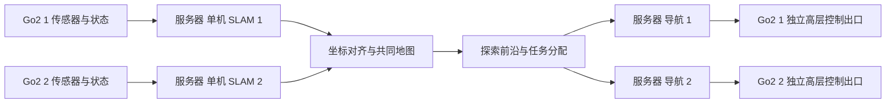

# 两台 Go2 与本机服务器的协同建图架构

用户明确的原始目标：两狗采集信息并传给本机服务器；服务器实时完成 SLAM 与协同建图，根据共同地图规划探索目标，再通过各狗高层运动接口执行，最终覆盖目标环境。

这个集中式方案可以作为两台机器人项目的主线。机器人负责传感器采集和高层运动执行，本机负责主要定位、建图、融合、规划和协调计算。两台机器人规模下先采用可解释、容易调试的集中式架构，后续再研究分布式或联合位姿图优化。

## 数据、坐标与控制归属

每狗的数据保留 robot ID、源时间、坐标系和对应里程计。单机 SLAM 分别维护本狗轨迹与地图；初始相对位姿测量后，把局部地图变换到共同坐标。环境地图仍可未知，初始位姿已知的条件在报告中披露。

不能把两狗的点云直接混入一个普通单机 SLAM，也不能仅给上层节点添加 namespace 就认为原始同名 DDS 数据/控制已经隔离。独立接入、源身份、显式 frame ID 和独立命令出口都需要双机实测验证。

服务器统一分配前沿目标，分别运行各狗的导航执行管线，并把目标/速度发到正确机器人。每狗原有高层运动控制负责实际步态与平衡，不需要服务器直接生成关节动作。

实时原始点云上传需要量测无线带宽、延迟和中断。先以实际有效频率实现两狗输入，再决定点云体素降采样和共享频率；不得用降低源时间精度或静默补造缺失点云掩盖传输问题。

运动执行与断联停车、控制权、人工接管形成独立链路，服务器任务失败或失联时能退出旧指令。当前有线实机测试继续由用户遥控，尚未启用服务器自主运动。

## 验收分层

1. 单狗服务器 SLAM：正确时间基准、TF、扫描、地图生成、保存及重载。
2. 单狗到点导航：参数化速度桥接、停车与控制权验证，规划/执行闭环。
3. 双狗独立接入：每狗定位/建图、唯一数据与命令归属。
4. 共同地图：初始坐标对齐、融合、地图版本与目标转换。
5. 协同探索：前沿提取、任务独占、成本/信息增益、失败重分配和让行。
6. 结果评估：目标场地中可达、可观测区域覆盖率，达到覆盖目标的时间、重复率、地图质量与干预。

“完整地图”需要明确实验边界及参考区域。墙后、封闭或传感器不可见区域不能通过探索自动观测；在线结束条件与离线覆盖评估分别记录。当前短路径产生的是局部地图，不能据此宣称完整地图或精度验收已通过。

## 与当前实现的关系

`go2_slam_bringup` 正在完成第一层：服务器接收原厂机体点云和里程计，在本机完成时间适配、TF、二维扫描与 `slam_toolbox`。回放模式使用与实机隔离的本地 DDS 域，只发布感知与地图。

当前启动配置是单狗基线；双狗命名、frame 转换、地图融合和任务分配仍需后续实现。复用两套 SLAM 后，融合模块再发布共同地图并供各狗规划使用。
