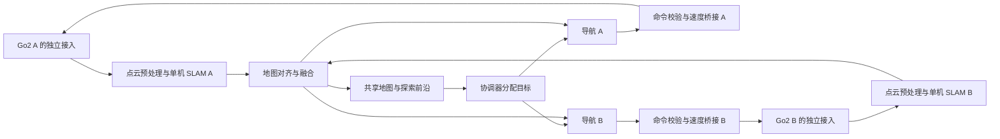

# Go2 多机器人协同探索与共同建图：每周一个周末实机日的推进规划

修订日期：2026-10-10。需求依据：[requirement.md](requirement.md)。

已确认约束：2026 年 12 月结项、开发人数 2 人、每周周六或周日约 8 小时能够实际接触机器狗。目前只有 1 台，后续预计可用 2 台，第二台到场日期未确认。本文替代此前按频繁现场调参安排的版本。

2026-10-10 更新：今天能够使用 1 台 Go2，首轮 D1 提前到今天，执行 [今日任务单](today_tasks_2026-10-10.md)。后续表格保留原有验收窗口，10/17 或 10/18 优先用于 D1 缺口补采；今天数据合格且下次候选离线通过时，可开展 D2。后续阶段按实际通过结果调整，不假设第二台会提前到场。

当日离线完善：回放已增加完整精度地图保存与失败检查，质量评估仍将源连续性和独立几何标为未完成。下一现场优先执行 [充电后的静止对照与地图验证卡](/home/yaorz/unitree_go2_ws/docs/next_robot_session.md)，当前三组量化成果见 [离线质量结果](/home/yaorz/unitree_go2_ws/docs/offline_quality_2026-10-10.md)。

原计划使用 10/17 或 10/18 起的 7 个周末：前 3 次集中验证单机；第二台最迟从第 4 次开始到场时，第 4–6 次完成双机基础、协同演示和对照，第 7 次保留重试。加上今天已有一次可用机会，后续周末仍需预约。11 月 30 日交付代码、视频、PPT 与实验素材；12 月用于复现、必要修复和答辩。

每个周末选择周六或周日中的一天，不是两个实机日。周末日期是建议窗口，具体预约仍需确认。第二台尚未落实，因此双机实机里程碑均带资源前提；人日、参数和性能指标均为规划估计。

## 1. 目标边界与开发、现场两类资源预算

最终主线仍是：两台 Go2 在没有预先环境地图的室内平面区域中，自主探索、协调不同目标、交换地图并在线生成共同二维地图。

首轮测量两狗初始相对位置和朝向，采用集中式协调、单机 SLAM 与地图融合。初始位姿已知不等于环境地图已知，但这一条件必须披露。任意初始位姿自动配准、三维闭环地图、第三台机器人和复杂学习算法安排在本轮之后。

| 资源 | 已确认条件或预算假设 | 排期处理 |
|---|---|---|
| 开发人数 | 2 人；离线每周有效投入尚未确认 | 人日估算按每人每周 4 天离线 + 1 天现场，共 5 个工作日；不依赖每周 6 天工作 |
| 实机访问 | 每周周六或周日中的 1 天，约 8 小时 | 10/10 已确认，加 10/17–11/29 的 7 个待预约周末，最多 8 个窗口；不默认次日能重测 |
| 当前机器人 | 只有 1 台 Go2 | 第 1–3 次现场验证单机；双机算法用两个独立模拟机器人实例开发 |
| 第二台 | 后续预计可用，日期待确认 | 目标预约 11/07 或 11/08 起的第 4–7 次；越晚到场，双机复测窗口越少 |
| 场地 | 首轮 1 个固定、可重复布置的平整室内场景 | 可移除障碍用于离线/模拟布局变化；第 2 场地列为加测 |
| 截止日期 | 12 月结项，具体日期未确定 | 11/29 最后必要现场证据，11/30 提交完整材料；不预支 12 月实机机会 |
| 接入与算力 | 协调主机、每狗独立接入通道 | 网络方案在 D1 调查、离线准备；真正的双机原始 DDS 隔离在第二台到场后验收 |

开发工时与场地时间分别计算：两人每周各 5 个 8 小时工作日，后续 7 周理论容量为 70 人日；加上今天两人现场共 2 人日，总估算 72 人日，主线预算调整为 60 人日、机动 12 人日。实际离线投入不足时重估，不把估算当作承诺。

包括今天，最多 8 个周末窗口 × 8 小时 = 64 个场地小时。D1–D6 的必要主线共 48 小时，10/17 或 10/18 增加 8 小时补采/进阶，D7 保留 8 小时机动。单次主要验证与复位占 5 小时，其中运动/录制约 3–4 小时，余下用于复位、充电和运行间隔；不能按全部场地小时连续运行安排实验。

正式实机对照先安排 1 个场景、3 种策略、每种 2 次，共 6 次运行；导航实机样本累计 8–10 个登记任务。闭环仿真承担多场景/多种子比较；实机小样本用于机制与可行性验证，无法单独证明稳健统计优势。

只有 1 台期间完成单机控制、建图、导航、探索和真实数据回放；双机融合/协调开发在闭环模拟中完成。顺序采集同一台狗的两份地图能够检查融合接口，但不算同时双机实机协同证据。

## 2. 当前起点与必须先解决的问题

已经具备：Go2 高层运动控制、状态和里程计记录、点云采集、点云后处理、局部二维投影地图。现有 Go2 功能包、KISS-ICP 和接入包都有历史构建成功记录。现有数据包含约 287 万个原始点、4,711 条运动记录及 5 cm/10 cm 两种投影地图。

现有依赖核查：ROS 2 Humble；`slam_toolbox` 2.6.10、`pointcloud_to_laserscan` 2.0.1、KISS-ICP 1.3.0；`nav2_msgs` 可见，但当前已加载环境中没有 `nav2_bringup`。导航组件需要单独核对、安装并固定兼容版本。

| 编号 | 已发现的问题 | 实施处理 | 关闭条件 |
|---|---|---|---|
| B01 | KISS 投影启动节点名是 `kiss_map_projector`，参数文件节点键是 `go2_cloud_map_projector` | 作为候选路线维护任务统一名称；不阻塞二维主线 | 启用该路线时，运行参数确认订阅 `/kiss/local_map`、使用 `kiss_odom` |
| B02 | 10/10 实机已确认 `/utlidar/cloud_base` 由机器人侧发布，frame=`base_link`，接收约 12–15 Hz | 已关闭话题不存在的疑问；首轮 SLAM 使用此输入，继续检查间隔与时间关系 | 当天原始录制及接口报告已保存 |
| B03 | `/utlidar/cloud_deskewed` 为 `odom`，另有可用机体点云 | 二维主线使用 `cloud_base`，暂不新增反变换；后续换原始三维输入时再确认完整姿态与外参 | 输入数值坐标和 frame 一致，时间基准适配通过 |
| B04 | 原投影只有占据/未知；10/10 已通过 `slam_toolbox` 回放生成自由/占据/未知地图 | 已完成单机服务器建图与保存重载，继续验收实时输入及地图几何质量 | 三类语义保存重载不变；自主导航可用性仍需独立验证 |
| B05 | `go2_safe_move` 是固定时序动作；当前源码速度为 0.3 m/s、0.50 rad/s | 新增参数化速度桥接、超时停车、控制权切换；测定运动响应 | 可持续接收导航速度，失去命令后发出停车请求，控制权状态可追踪 |
| B06 | 现有节点使用绝对原始话题名和通用 TF 名称 | 参数化话题与 frame ID，设计每狗独立接入及统一出口 | 双机运行时数据可归属到唯一 robot ID，命令不会串发 |
| B07 | 新增源码和文档未完整进入版本管理，构建产物混入仓库 | 保留原始数据，整理源码、依赖清单、数据目录和忽略规则 | 从干净检出构建，使用固定数据复现基本处理流程 |
| B08 | 状态日志使用“最新里程计”拼接，缺失时写零 | 新日志分别保存源时戳、接收时戳、有效标志和数据年龄 | 缺失数据与真实零值可区分，运动/建图评估使用明确的时间对齐规则 |
| B09 | 10/10 时钟差约 2173 秒、机器人原始无 TF；下午新包点云最长源间隔约 8.67 秒 | 公共时间适配、动态 TF、运动补偿扫描已通过实时及回放；已修正转向门限，源间隔仍保留诊断 | 地图保存重载通过；下一次优先十分钟连续性及独立几何验证，详见 [接入结果](/home/yaorz/unitree_go2_ws/docs/slam_status_2026-10-10.md) |

相关代码依据：

- [KISS 启动配置](../src/go2_kiss_icp_bringup/launch/go2_kiss_icp.launch.py)、[投影参数](../src/go2_kiss_icp_bringup/config/kiss_map_projector.yaml)。
- [TF 桥接](../src/go2_tf_bridge/src/go2_tf_bridge.cpp)：当前默认把姿态压成平面，点云预处理需要评估完整姿态转换。
- [地图投影](../src/go2_cloud_map_projector/src/go2_cloud_map_projector.cpp)：适合现有感知展示，需要补足导航地图语义。
- [运动程序](../src/go2_safe_move/go2_safe_move/src/go2_safe_move.cpp)、[状态记录](../src/go2_state_logger/go2_state_logger/src/go2_state_logger.cpp)。

## 3. 技术主线与系统结构

### 3.1 建图与导航的选择

主线采用：公共时间适配 → 一秒点云累积与逐点运动补偿 → 二维扫描 → `slam_toolbox` → Nav2 → Go2 Sport API 速度桥接。单帧 `pointcloud_to_laserscan` 保留用于对照，默认改为已验证的累积扫描入口。

选择依据是当前工程已有二维 SLAM 接入代码和依赖，二维地图能直接服务于室内探索、前沿提取和多机地图融合。D1 后用固定录制数据调试，D2 用现场闭环路径验证该路线，达标后固定主线配置。

KISS-ICP 保留为主线提前达标后的里程计对比候选。其现有实现是激光里程计与局部点云地图，局部地图会删除远处点；它不是自动维护的全局闭环地图。若原厂里程计确实成为已验证的主线阻塞，再评估 KISS 替代；切换必须重新验证自由空间地图、TF 与导航，而不是把候选方案当作即插即用的全局建图。

### 3.2 系统数据流



每台机器人负责实时运动与近距离障碍处理；协调主机负责地图融合、全局前沿、任务分配和实验记录。协调器短时失联时，机器人本地仍能执行停车与人工接管。

### 3.3 通信与坐标系约定

原始 Unitree DDS 话题可能在两台机器人上同名。仅在上层启动文件中加 namespace，不能隔离已经混在一起的原始数据，也不能确定控制命令对应哪台机器人。

D1 核查现有机器狗的固件、接入接口、IP 和 DDS 配置，离线准备独立接入方案；第二台到场后才能验收真正的双机归属和隔离。推荐采用每狗独立接入网络/接入主机，再把允许的数据桥接到统一协调网络。若使用 DDS 域隔离，必须确认机器人端和接入端配置一致；仅改变电脑端 `ROS_DOMAIN_ID` 可能造成无法发现机器人。具体隔离实现经设备验证后确定。

统一 robot ID 为 `go2_1`、`go2_2`；应用层话题使用 `/go2_1/...`、`/go2_2/...`，frame ID 使用 `go2_1/map` 等形式，不加开头斜杠。namespace 不会自动修改消息内的 frame ID，需要显式转换与核对。

每狗预期 TF 主链：

```text
global_map -> go2_i/map -> go2_i/odom -> go2_i/base_link -> go2_i/lidar
```

其中 `global_map -> go2_i/map` 由地图对齐模块发布，`map -> odom` 由单机 SLAM 发布，`odom -> base_link` 由选定的唯一里程计链路发布。KISS 和原厂里程计不能同时争用同一条 TF 边。需要 `base_footprint` 时再明确拆分完整姿态关系。

点云坐标转换使用原始完整姿态和标定外参；导航的平面姿态处理需要与该转换保持一致。优先验证现有桥接的完整姿态模式，避免用丢弃滚转、俯仰和高度的 TF 去反变换已经在 `odom` 下的点云。

导航从单机自己的地图起步。双机融合后，由融合模块把共享地图转换/重采样为各自 `go2_i/map` 下的 `/go2_i/planning_map`，供各狗 Nav2 全局代价地图使用；实时局部障碍物仍来自本狗传感器。这样可以利用另一台机器狗发现的空间，同时保持单机定位链路。

已知初始位姿对齐时，结合测量的相对位置与同一时刻每狗在本地 SLAM 地图中的位姿计算地图变换，不能假定两狗启动时本地坐标都为零。融合先按统一分辨率重采样，保留未知/空闲/占据语义，记录每狗地图版本和更新时间；数据过旧或对齐失效时暂停跨狗新任务。

## 4. 7 个周末实机窗口与离线开发循环

### 4.1 每个现场日的目标与离线准备

现场日编号采用 D1–D7，策略编号采用 S1–S4，实验目录分别保存 `session_id` 与 `policy_id`。

| 次数 / 周六或周日二选一 | 进场前离线必须完成 | 当天主要目标 | 离场必须带走的证据 |
|---|---|---|---|
| D1：提前到 10/10，1 台；10/17 或 10/18 补采/进阶 | 录制工具、元数据、依赖与存储；人工采集流程；调查后续双机资源 | 建立完整真实数据集与硬件接口基线 | 点云、原厂里程计、状态、完整姿态/外参、时间与接口资料；场地/电池/接入调查 |
| D2：10/24 或 10/25，当前 1 台 | D1 数据完整回放；SLAM 输入与速度桥接验证；已知可用版本 | 运动响应、超时停车和在线建图验收 | 命令/响应、停稳距离、闭环建图与更新后的原始数据；第二台预约结论 |
| D3：10/31 或 11/01，1 台即可 | 同一导航栈闭环模拟到点/绕障/取消；D2 控制与地图通过 | 到点导航，达标后短时自主探索 | 累计 8–10 个登记任务的结果；至少一次自主探索、地图与视频 |
| D4：11/07 或 11/08，目标 2 台 | 双管线、固定初始位姿融合、共享规划地图与命名/接口模拟通过；第二台独立控制测试卡 | 验证第二台能力、双机命令隔离和共享地图导航 | 第二狗运动/停车基线、同步双机数据、初始位姿、共同地图与每狗导航记录 |
| D5：11/14 或 11/15，需要 2 台 | D4 硬件与对齐通过；分配器、租约和通行规则闭环模拟通过 | 双机协同探索核心演示 | 8–10 分钟完整双机运行、任务事件、共同地图、实机录制和视频 |
| D6：11/21 或 11/22，需要 2 台 | 修复 D5 关键问题；固定版本、参考区域、起点与 6 次运行矩阵 | 正式实机对照与最终演示 | S1/S2/S4 各 2 次，含失败/超时数据、版本及参数快照 |
| D7：11/28 或 11/29，按缺口预约 | 已定位需要重试的具体问题，或核心证据已经齐全 | 延期重试或补录；全部通过时追加重复 | 最终必要证据、演示与备份；不增加新主线模块 |

D1–D3 有单台即可推进；双机命名/协调可以离线开发，但原始 DDS 隔离、第二台控制和真实相遇行为在 D4 之前不能视为已通过。D4 先对第二台单独复核，再允许双机自主运动，不能把第一台测试结果直接套用到第二台。

D3 探索属于导航通过后的进阶任务。当天只能到点导航达标时，D4 上午优先补单机探索，同时缩减当日双机动作范围。主要前置条件未通过时，现场以定位问题和补采数据为目标，后续物理阶段按实机机会顺延。

正常资源条件下，D5 核心演示、D6 对照、D7 保留一次重试。第二台如果到 D5 才可用，双机基础/核心演示/对照分别顺延到 D5/D6/D7，最后一次机动被占用；这一版本风险更高，不能再承诺额外复测日。

### 4.2 两人的每周离线循环

| 时间位置 | A | B | 共同产物 |
|---|---|---|---|
| 现场后首个离线工作日 | 分析感知、TF、运动与导航片段 | 检查录制完整性、任务事件和失败片段 | 24 小时内数据质量结论及问题清单 |
| 随后 2 个离线工作日 | 修复并回归感知/建图/桥接/导航 | 回放/模拟接口、前沿/融合/分配及指标 | 在同一固定数据上可重现的修复证据 |
| 进场前最后一个离线工作日 | 合并候选版本，完整启动/停止 | 检查场景、试验表、记录与对照配置 | 固定候选与回退版本、下一次测试卡 |
| 周六或周日其中 1 天 | 执行登记流程与指定机器人接管 | 观察、记录与另一机器人接管 | 当次验收、录制和双份备份 |

候选版本至少进场前 24 小时冻结。现场避免安装依赖或新增算法；必要缺陷修正记录版本差异并重测受影响项。周末日期确定后调整这个循环，人员休息和现场复盘纳入每周 5 个工作日预算。

### 4.3 每次 8 小时的现场预算

| 活动 | 场地小时 | 用途 |
|---|---:|---|
| 接入、机器人/版本身份核对 | 0.5 | 记录硬件、网络、电量和时间基准 |
| 已验证版本短回归 | 0.5 | 排除场地、网络与状态变化 |
| 当次主要验证 | 3.5 | 预登记目标；D4 先验第二狗独立控制 |
| 复位、电池处理、运行间隔 | 1.5 | 保持起点与实验条件可比 |
| 数据抽查 | 0.5 | 检查真实消息载荷、运动片段与事件 |
| 双份备份、清场与归还 | 0.5 | 避免带走不完整数据 |
| 未预期问题机动 | 1.0 | 有上限的诊断、重试或补采 |
| 合计 | 8.0 | 主要验证与复位共 5 小时 |

D6 六次运行先按每次 8–10 分钟运行、5–10 分钟复位估算，共约 78–120 分钟。即使连续 6 次未达到覆盖目标，仍按登记时限结束并记录未完成；可加测时间取决于真实电量、复位和系统状态。

现场连续诊断 30 分钟仍无法定位时，回退可用版本并补采症状。最后 30 分钟保留给检查、备份与归还。单个当天可以安排先后验证，但不得因为离线已经通过而跳过第二台停车与控制归属核验。

### 4.4 无机器人期间的三类验证与边界

| 环境 | 必须准备的能力 | 能验证 | 仍依赖实机 |
|---|---|---|---|
| 真实数据回放 | 感知、里程计、状态、TF、外参；明确回放时钟和源时戳 | 点云/扫描、SLAM、地图融合、诊断和计算回归 | 新动作对未来轨迹与观测的影响 |
| 运动与观测闭环模拟 | 速度改变机器人位姿；当前位置生成扫描且考虑遮挡；复用 Nav2/探索/协调接口 | 导航、探索、分配、相遇场景、故障恢复和效率对照 | Go2 运动响应、真实障碍感知、网络与停止距离 |
| 模拟接口与故障输入 | 延迟、掉线、过旧数据、任务拒绝、取消、租约过期、接管 | 命名与任务归属、状态机、停车请求生成和恢复 | 真正的原始 DDS 隔离与物理停车 |

固定轨迹回放不能证明新探索策略更优；回放中发出不同速度也不会改变已录制点云。策略效率与闭环控制比较使用动作改变观测的模拟和真实运行。

现有 CSV/PLY 适合点云后处理与展示，缺少完整时序、TF 和逐帧消息，不能替代 D1 原始 rosbag。D1 优先拿到以后每周可反复利用的数据。

优先恢复既有仿真，投入限 1 人日；不能恢复时建立轻量二维运动/扫描模拟，避免新建复杂四足物理仿真。模拟中先只有一狗再加入两狗；第二狗的模拟实例不算已接入第二台 Go2。三种验证共用话题与动作契约，尽量共用导航/探索/分配代码。

### 4.5 各次通过条件

- **D1 数据**：点云非空、直行/转向片段存在、原厂里程计完整；源时戳、记录时间、frame、外参与 QoS 有说明；离场前可读取，离线可以构建正确的回放链路。
- **D2 控制/建图**：至少 6 次短动作试验；超时、进程退出和人工接管发出停车请求；请求延迟和实际停稳距离分别测量。连续在线建图 10–15 分钟，保存地图与一次闭环结果。
- **D3 导航/探索**：累计 8–10 个登记可达任务，报告原始成功/失败及误差；目标成功率 90%、到点误差 ≤0.3 m 仅作为调试目标。达标后自主探索 5–10 分钟，有新增地图与目标重选证据。
- **D4 双机基础**：第二台独立运动/停车通过；每狗数据与命令唯一归属；共同结构对齐中位误差初始目标 ≤0.2 m；每狗共享规划地图和目标转换可用于导航。
- **D5 协同闭环**：至少一次 8–10 分钟双机运行，存在不同任务和共同地图增长；记录干预及失败；验证一狗暂停后任务释放/重分配。暂停与失联先在静止状态验证停车，再扩大范围。
- **D6 对照**：3 策略各 2 次，同版本、布局、起点、速度、分辨率与时间上限；每次从未知地图开始，记录失败/超时。参考区域仅用于离线评估。
- **D7 / 交付**：必要重试或补录完成，原始数据、图表、地图、视频与固定版本可对应；未通过的实机部分明确列出。

上述目标按 D1/D2 场地尺度和测量质量确认。两次/策略的小样本报告每次结果，不把模拟成功率或离线通过数计入实机成功率。

材料与现场并行积累：D2 后保存建图图例，D3 后保存单机导航/探索视频，D5 后形成双机核心演示；11/27 前完成 PPT、报告结构及可自动刷新图表，D7 新证据随后更新，11/30 最终核对交付。D7 若承担正式对照，采用已经固定的评估工具生成曲线，不把整份材料撰写推迟到最后一天。

## 5. 拟新增模块与现有模块改造

以下模块均为规划项；优先建立逻辑边界，可按规模合并为较少 ROS 包，不要求一次创建所有目录。

| 模块/建议包名 | 主要职责 | 主要输入 | 主要输出 |
|---|---|---|---|
| `go2_lidar_preprocess` | 点云坐标转换、本体/高度过滤、时间语义校验 | 原始点云、完整姿态、外参 | 机体/传感器点云、扫描输入与诊断 |
| `go2_cmd_bridge` | 速度到 Sport API、限幅、控制权与超时停车 | 本狗导航速度、运行状态 | 本狗独立命令出口、控制诊断 |
| `go2_navigation_bringup` | Nav2 配置、定位/建图模式切换 | 地图、扫描、TF、目标 | 导航执行与结果 |
| `go2_exploration` | 前沿提取、可达性过滤、单狗状态机 | 导航地图、位姿、任务结果 | 候选前沿、单狗探索目标 |
| `go2_multi_bringup` | robot ID 配置、独立接入与命名、双机启动 | 每狗接口与配置 | 两套独立机器人管线 |
| `go2_map_fusion` | 初始对齐、融合、版本和规划地图发布 | 每狗地图、相对位姿 | 共同地图、对齐 TF、各狗规划地图 |
| `go2_task_allocator` | 协同分配、租约、重分配和通行协调 | 前沿、位姿、路径代价、健康状态 | 每狗目标与任务事件 |
| `go2_experiment_tools` | 元数据、录制/回放、轨迹和指标计算 | 状态、地图、任务及网络记录 | 实验目录、曲线、汇总表 |

现有包的处理：

- `go2_tf_bridge`：参数化话题和 frame 映射；明确完整姿态与平面导航关系，检查输入非空 frame 时现有 fallback 参数不会覆盖的问题。
- `go2_state_logger`：参数化话题，增加 robot ID、有效标志与时间对齐记录。
- `go2_lidar_snapshot` / `go2_lidar_filter`：继续用于离线感知成果，明确其地图语义和与导航地图的区别。
- `go2_slam_bringup`：补齐点云预处理、运行诊断、保存流程及每狗配置。
- `go2_kiss_icp_bringup`：修正参数匹配、补齐依赖；作为对比路线，避免发布冲突 TF。
- `go2_cloud_map_projector`：保留展示用途。若升级为导航地图，需要明确自由空间观测、地面过滤、坐标校验和证据更新；不能只改地图名称完成升级。

## 6. 接口与运行约束

| 应用接口 | 约定 | 验证重点 |
|---|---|---|
| `/go2_i/points` | `PointCloud2`；frame 与数值坐标一致 | 点字段类型、时间与传感器外参 |
| `/go2_i/scan` | `LaserScan`；使用本狗传感器 frame | 地面/机体过滤、遮挡与扫描视野 |
| `/go2_i/odom` | `Odometry`；带父/子 frame | 连续性、来源唯一、QoS 与时戳 |
| `/go2_i/map` | 单机 `OccupancyGrid`，处于 `go2_i/map` | 自由/占据/未知语义、地图更新 |
| `/shared_map` | `OccupancyGrid`，处于 `global_map` | 分辨率、原点、重采样、对齐版本 |
| `/go2_i/planning_map` | 共同地图转换到 `go2_i/map` | 与目标转换一致；数据过旧时禁止新任务 |
| `/go2_i/cmd_vel` | 初版按 Humble 适配的 `Twist` | 仅对应本狗命令出口；限幅与超时 |
| `/go2_i/navigate_to_pose` | Nav2 `NavigateToPose` action | 目标处于本狗地图坐标，取消与失败可追踪 |
| `/go2_i/robot_status` | robot ID、状态、数据年龄、任务状态 | 区分离线、故障、暂停、忙碌和可用 |
| 协同任务事件 | task ID、robot ID、版本、租约和事件时间 | 幂等接受、避免旧任务恢复后重复执行 |

任务/状态先定义字段契约，可在专用接口包中实现；消息类型与配置文件一同版本化。

传感器频率先测量再设阈值，地图共享初始预算为 1–2 Hz，协调状态/心跳初始预算为 2–5 Hz。跨机器时间同步先测定误差，50 ms 可作为低速阶段的初始目标；机器人端时戳若非同一时间基准，要记录转换/偏移，不能直接混用。

共享优先传输地图、位姿和任务，原始点云留在本地处理并按实验需要录制；以实测带宽决定是否启用地图增量更新。地图中断时保留上一版本并标记过旧，不能默认为仍然有效。

速度桥接校验输入有限值、范围和控制权。障碍缓冲由机器人轮廓、感知数据年龄、端到端延迟、实测制动距离和定位误差共同确定。运动相关恢复行为先在模拟环境验证。

## 7. 协同策略与实验设计

### 7.1 首轮分配策略

必做版本先实现“可达性与路径成本 + 信息增益 + 任务独占”，固定目标切换迟滞。下面的重复观测与切换成本项作为改进版本，只有 D5 核心演示达标且正式实验版本尚未冻结、仍有机动时间时启用。实验配置必须标明哪些项实际开启。

对机器人 i 和前沿任务 j，采用可解释的效用模型：

```text
U(i,j) = w_gain * 预期新增可观测面积
       - w_path * 规划路径长度
       - w_overlap * 与其他任务的预期重复观测面积
       - w_switch * 目标切换代价
```

各项先归一化，权重在调参场景固定后冻结。不可达、位姿/地图过旧、通道冲突未解决或机器人不可用时，将候选判为不可分配，不用软惩罚掩盖不可执行任务。

信息增益考虑传感器视野、量程和遮挡；首版可用射线或可见性近似。重复观测项估计候选视野与已知区域、其他机器人的计划观测区域交集。权重是否有效由消融实验验证。

### 7.2 对照与消融

| 策略 | 目的 | 使用范围 |
|---|---|---|
| S1：单狗最近可达前沿 | 基础探索能力与时间参照 | 模拟与实机 |
| S2：双狗独立最近前沿，共享地图但不协调任务 | 区分增加机器人数量和任务协同的作用 | 模拟与实机 |
| S3：双狗统一分配，只使用路径成本 | 分离任务唯一分配与信息增益的作用 | 模拟；资源允许时扩展实机 |
| S4：双狗统一分配，加入信息增益 | 评估本轮协同策略；可选版本额外加入重复/切换成本 | 模拟与实机，固定并披露实际启用项 |

S2 和其他策略使用同样的底层避障及通道安全机制，任务层可重复选择前沿；不能通过给基线降低安全能力来制造优势。

若某一方法实现不同底层建图或导航配置，需要单独做控制实验，不将所有变化归因于分配策略。协同策略的研究贡献应由实验确认的效率或稳定性改进支撑。策略对照使用 policy S1、S2、S4；policy S3 在模拟环境中提供必要消融。模拟计划 2 个布局 × 4 种策略 × 3 个种子，共 24 次；实机计划在双机资源按时到场时执行 1 个布局 × 3 种策略 × 2 次重复，共 6 次，主要用于可行性与机制验证。较少重复不能支撑稳健的统计优势结论。

### 7.3 指标与计算约定

| 指标 | 定义/测量方式 | 初始目标或用途 |
|---|---|---|
| 覆盖率 C(t) | 各狗已观测区域并集与固定可观测参考区域的交集面积 / 参考区域面积 | 以 90% 为调试目标；参考区域仅离线评估使用，未达标也报告曲线 |
| T90 | 第一次达到 90% 覆盖的时间 | 主效率指标；未达到时记录失败/截尾，不能伪造完成时间 |
| 重复率 R | 至少被两台不同机器人观测的面积 / 两狗观测区域并集面积 | 配准所需初始共同区域单独报告；本人多次观测不计为跨狗重复 |
| 导航成功率 | 可达登记任务中的成功数量 / 可达任务总数 | 实机累计 8–10 次，报告原始次数；90% 为调试目标 |
| 地图对齐误差 | 独立选定对应结构/标记在共同坐标中的距离误差 | 报告中位数、较高分位数和测量误差 |
| 地图质量 | 墙体重影、自由区/障碍区一致性；有参考时计算栅格一致性 | 防止“覆盖变快但地图变差” |
| 总路线长度 | 按固定采样与异常过滤规则累积两狗轨迹 | 比较路径开销 |
| 通信开销 | 实验期间应用/网络实际收发字节与峰值数据率 | 比较地图共享成本 |
| 人工干预与故障 | 人工接管、停车、掉线、失败恢复次数和原因 | 评估自主程度与稳定性 |

覆盖与重复观测的原始证据来自各狗自身传感器或本地 SLAM 地图，再变换到共同坐标系。共享规划地图已经包含另一台机器狗的信息，不能把读取共享地图当作本狗完成观测，否则重复率和覆盖率会失真。

效能研究目标：在可比的双狗独立基线 S2 上，争取降低 T90 和重复率，例如把 T90 降低 15% 作为调研目标。该数值是待验证假设，不是系统完工保证；没有获得稳定改善时仍应报告真实结果并分析原因。

模拟报告每个场景/策略的均值、离散程度和样本数，足够样本时报告置信区间；实机样本较少时呈现每次运行结果。多种子比较优先使用匹配场景和起点，失败样本进入统计。

## 8. 数据与版本交付

建议实验目录结构，目录和文件在实施中创建：

用户已指定未来大文件优先保存到移动硬盘 `/media/yaorz/Elements/unitree_go2`。原始录制、大点云、地图、视频及批量仿真数据使用这个根目录；源码、脚本、文档、小配置和数据索引保留在项目工作区。写入前检查挂载及可写性，外盘不可用时停止并报告，不静默改写到本机磁盘。

```text
/media/yaorz/Elements/unitree_go2/experiments/<日期>_<场景>_<策略>_<重复编号>/
  metadata.yaml          # 机器人、场景、起点、软件/配置版本与时间基准
  config/                # 当次使用的参数快照
  rosbag/                # 感知、TF、状态、任务和地图
  maps/                  # 每狗地图、共同地图及元数据
  trajectories/          # 带有效标志和统一时间语义的轨迹
  events.csv             # 任务分配、取消、失败、通信和控制权事件
  metrics.json           # 由评估工具计算的指标
  media/                 # 视频、地图截图与曲线
```

原始数据保持可追溯，处理结果记录输入数据和工具版本。较大实验数据使用单独存储和索引，源码仓库保留配置、元数据、示例及恢复说明。

备份需要另一个存储设备或独立存储位置；同一 Elements 硬盘上的目录副本不算独立备份。

每次现场按 sensor_msgs PointCloud2 原始载荷、原厂 odometry、SportModeState、实际存在的 TF/静态 TF、运行时地图、导航状态、任务/控制事件录制。保存类型定义、QoS、外参、源时戳与接收时间的含义及代码/配置快照；缺失 TF 必须记录缺口，可用原厂完整里程计重建的链路也需要保存依据。

离线模式至少分为 hardware / replay / simulation，明确输入时钟与控制出口。回放和模拟中的速度/控制请求只进入验证输出，不连接实机 Sport API。硬件模式需显式选择 robot ID 和独立出口，并启用停车/人工接管。回放的模拟时钟与原始机器人时戳若不一致，采用有记录的时间映射，不在原始数据上静默改写。

录制与回放重点保存传感器、地图、状态和任务事件。运动请求若用于分析而被保存，回放时必须排除控制出口并使用与实机控制隔离的环境，避免把录制命令重新发给机器人。

每个里程碑的最低材料：固定代码/配置版本、启动与停止说明、至少一份录制数据、地图/轨迹、验收结果和已知问题。第 2 周开始就持续积累成果，最终发布包括双机协同视频、对照曲线和复现实验说明。

## 9. 两人分工及工时、场地双重管理

| 角色 | 离线主责 | 现场主责 |
|---|---|---|
| A | 点云/TF、SLAM、速度桥接、Nav2与候选版本集成 | 执行登记流程、确认运动与控制状态，承担指定狗的接管 |
| B | 录制/回放、轻量模拟、前沿/融合/分配、评估和材料 | 观察、数据/视频记录与问题标记，承担另一狗接管 |

单台时期两人共同完成操作与观察；双台时期明确每人的接管对象，数据记录自动化，不能让现场改代码或手工填表占用观察职责。

| 工作包 | A 人日 | B 人日 | 合计人日 |
|---|---:|---:|---:|
| 环境、版本和接口准备 | 2 | 2 | 4 |
| 录制、回放、模拟接口与诊断 | 4 | 4 | 8 |
| 点云预处理与单机建图 | 4 | 2 | 6 |
| 速度桥接与导航 | 5 | 3 | 8 |
| 单机探索与闭环模拟 | 1.5 | 3.5 | 5 |
| 双机融合与协调 | 2.5 | 4.5 | 7 |
| 包括今天最多 8 次现场，各人 8×8 小时 | 8 | 8 | 16 |
| 评估、复现、视频和材料 | 3 | 3 | 6 |
| 主线总预算 | 30 | 30 | 60 |
| 其余开发机动容量 | 6 | 6 | 12 |

现场已计入 60 人日，不能重复加算。D7 现场机动已在 16 人日中；其余 12 人日是开发时间缓冲，不能额外创造实机访问机会。后续每周按 4 个离线日 + 1 个周末实机日排，不要求平日 5 天之外再工作 1 天。

现场后记录：实际可用小时、运行与故障数、数据是否足够离线修复、下次唯一主要目标、前置条件和剩余实机次数。功能通过、性能改善和实机证据分别验收。

## 10. 第二台到场时间及现场失败的处理

### 10.1 第二台资源的三种排法

| 第二台首次同时到场 | 后续排法 | 对交付的影响 |
|---|---|---|
| **11/07 或 11/08，D4，推荐目标** | D4 双机基础；D5 协同演示；D6 对照；D7 重试/补录 | 保留一次现场机动，最符合 11 月底交付目标 |
| **11/14 或 11/15，D5** | D4 单机探索/预采；D5 双机基础；D6 协同演示；D7 对照与最终补录 | 用掉原有机动，需进场前完成全部双机离线集成；实机失败后的余量很小 |
| **11/21 或 11/22，D6 或更晚** | D6 至少完成第二台与双机基础；D7 若前置通过再做协同 | 仅 1–2 次双机机会，不能保证正式对照与复测齐全；明确报告证据缺口，另行争取结项前实机窗口 |

第二台尚未到场不能自动停止单机与模拟工作，也不能把模拟双机成果写成实机双机。第 1 周联系落实设备、可用周末和第二台接口情况；到 D2 结束前应有 D4–D7 借用方案。若依旧不确定，持续将其列为主线资源风险。

### 10.2 其他失效条件

| 条件/风险 | 确认点 | 处理 |
|---|---|---|
| 本周实机日取消 | 预约前 | 把需要物理证据的阶段顺延；离线继续，D7 吸收一次延期 |
| D1 数据不完整 | 离场前 | 立即抽查补采，优先保护回放基础；现有 CSV/PLY 不够替代 |
| 坐标/时戳错误 | D1–D2 | 先离线修复和回归，避免占据下一现场日盲调扫描匹配 |
| 原始话题混流或串控 | 第二台到场当日 | 先独立接入并验证归属，未关闭前不开展双机自主运动 |
| 导航未达到探索前置条件 | D3 | 采集失败片段回放/模拟修复；D4 优先补导航/探索，减少双机动作范围 |
| 第二狗固件/接口/动作不同 | D4 或实际到场日 | 完成独立基线，不直接套用第一狗的参数与结论 |
| 连续两次访问丢失或关键问题反复失败 | 第二次发生时 | 重估完整双机实机目标和剩余证据，减少加测；不能用离线加班抵消实机次数 |
| 实际 8 小时含大量往返或充电，净现场更少 | D1 | 更新净预算；每次一个主要目标，优先保留验收/抽查/备份 |
| 策略未体现稳定优势 | D5–D6 | 如实报告小样本与模拟对照，12 月不新增研究主线 |

D7 前不增加新硬件、SLAM 后端或自动配准。第二场景、更多重复、通信压缩和复杂效用项仅在必要验收完成后加测。

若 D7 不足且结项日允许，可争取 12/05 或 12/06 的一次必要补测；这次未得到预约确认，不能作为按期完成的既定前提。

## 11. 第一周与 D1 的具体执行

10/10 已确认可上机，D1 按今日任务单执行。10/12–10/16 分析今日数据并离线开发；10/17 或 10/18 优先补今日缺口，数据与候选版本通过时可进阶到 D2。今天是已确认的单机机会，后续阶段资源依然逐次核实。

**A 离线：**固定已有代码/依赖；梳理点云、完整姿态、里程计与控制接口；准备 TF/预处理和运动桥接的模拟输出，利用现有 CSV/PLY 做静态检查。

**B 离线：**准备原始录制、诊断、事件与元数据；定位既有仿真并判断复用，建立时间/话题接口契约；联系第二台，目标安排 D4–D7 同时到场。

**D1 唯一主要目标：采集完整、可复用的单机原始数据。**当天不以完成自主导航为目标。

1. 确认后期双机借用路径、8 小时是否包含往返与充电、实际场地范围。
2. 核查源话题、类型、frame、时戳、QoS、接入接口，保存接口资料。
3. 按静止、人工低速直行、人工转向、人工闭环采集完整消息；至少保留 2 份明显运动变化的录制。
4. 测量机体轮廓、场地尺度、可复用起点标记与外参资料；检查实际电池/复位开销。
5. 有余量再采门口、局部遮挡、障碍变化等补充片段。单台期间的顺序地图样本可以服务融合开发，但标明采集方式。
6. 离场前读取关键片段、核查数据载荷和时戳，复制到两份存储，保留原始数据。

**D1 后首个离线工作日、尽量 24 小时内：**完成质量结论、接口表与缺口清单。A 回放点云转换/SLAM；B 接通录制/回放和模拟接口，输出 D2 测试卡。第二台本周无法确认则登记资源风险，不影响单机离线推进。

现场可填写模板：[实机验证与数据采集检查表](field_session_checklist.md)。

## 12. 本次规划的依据与验证范围

依据本工作区需求、源代码、安装包信息、历史构建日志和现有实验数据制定。多智能体仿真能力在 [交接文档](../helper/UBUNTU_CODEX_HANDOFF.md) 中有记录，但对应仿真工程不在本工作区；第一周确认其位置、版本和可复用范围，按第 4 节的恢复预算与轻量模拟方案实施。模拟结果、真实轨迹回放和实机结果分别报告。

此前外部文档检索服务不可用，未核验最新外部软件版本；本次修订重点是已确认的场地/设备约束与验证排期。路线以本地已安装 Humble 环境和现有源码能力为基准；新增 Nav2 组件、DDS 桥接工具或地图对齐库在引入时分别验证发行版兼容性、许可证和运行接口，不直接按最新发行版配置。
